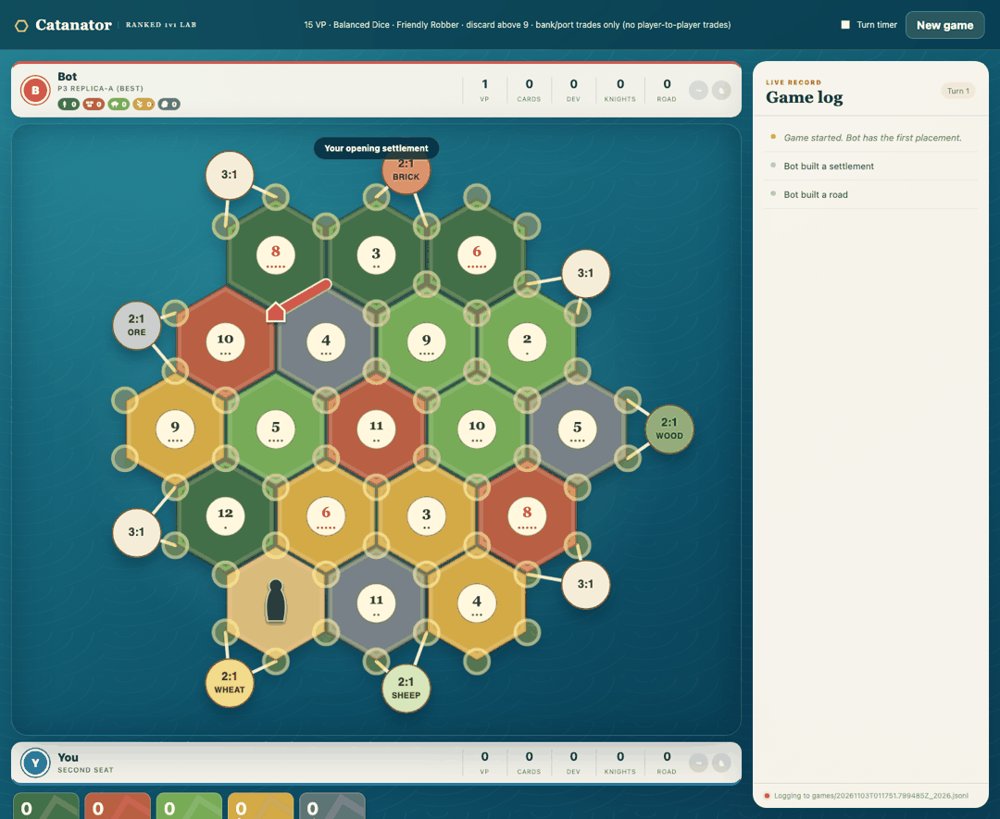

# Catanator

A bot for two-player Catan, built on a fast Rust game engine with a Python planner on top.
It plans whole turns, scores the position at the end of each turn with a learned evaluation,
and searches the opening snake draft to the end. You can play against it in your browser.

It is strong against other bots in simulation. It is not yet strong against good humans, and
the sections below say exactly where it is stuck. Help is welcome.



## Ruleset

The engine implements a competitive 1v1 ruleset:

- 15 victory points to win
- Balanced Dice: rolls are drawn from a 36-card deck of every two-dice outcome, reshuffled
  when it runs low, instead of independent random rolls
- Friendly Robber: the robber cannot be placed on a hex touching a player with fewer than
  3 visible points
- Discard half when holding more than 9 cards on a 7
- Bank and port trades (no player-to-player trade offers)

## How it plays

1. **Turn planner.** Enumerates complete own-turn action sequences (beam-pruned, up to 128
   plans of up to 14 actions) and evaluates only at the end of the turn, before the opponent
   rolls. Hidden information (opponent hand, dev deck) is handled by sampling worlds that are
   consistent with public counts.
2. **Value function.** A 24-term linear evaluation over the end-of-turn state (production,
   resource diversity, buildable sites, road length, army, dev cards, opponent production,
   and so on). The weights in `weights/champion.json` were tuned with diagonal CMA-ES in a
   self-play arena: 8 independent replicas, 12 generations each, 400 mirrored games per
   candidate.
3. **Opening draft search.** For setup, it runs alpha-beta over the entire remaining snake
   draft (diverse settlement beam, every legal road direction, opponent as minimizer), then
   scores the post-setup position. This was the single biggest gain in the last month.

## Results (simulation only)

Every match is played in **mirrored pairs**: the same seed is played twice with seats
swapped, so luck from the board and dice mostly cancels. Scores are mean points per game
(win = 1). Promotions use a sequential probability ratio test (SPRT) instead of a fixed
game count.

| Matchup | Pairs | Score |
|---|---:|---:|
| Champion vs greedy builder | 4,000 | 0.709 ± 0.005 |
| Champion vs previous champion (depth-2 alpha-beta, hand-tuned eval) | 4,000 | 0.646 ± 0.005 |
| Previous champion vs Catanatron `AlphaBeta(depth=2)` | 400 | 0.743 |

**Engine speed.** The Rust engine runs 114x more games per second than the Python
reference engine, single core. It was checked move by move against the reference on
654,627 plies across 486 complete games with zero divergences.

Simulator strength is not human strength. A bot that beats other bots can still lose to a
person who plays around its habits.

## Quick start

Needs Python 3.11+ and a Rust toolchain (the pinned version installs itself through
`rust-toolchain.toml` if you use rustup).

```bash
python3.11 -m venv .venv
.venv/bin/pip install -r requirements.txt
.venv/bin/maturin develop --release --manifest-path fast_engine/Cargo.toml
PYTHONPATH=. .venv/bin/python -m pytest -q
```

**Play against it:**

```bash
scripts/play_vs_bot.sh
```

Then open http://localhost:8765. Each game is logged to `games/` as JSONL and can be
replayed exactly from its seed and action list.

**Run a match between two bots:**

```bash
PYTHONPATH=. .venv/bin/python scripts/run_value_arena.py \
  --candidate weights/champion.json --candidate-setup-draft-search --candidate-setup-draft-features \
  --baseline champion \
  --max-pairs 400 --workers 4 --elo1 10 --output results/my_run.json
```

With opening search on, one pair takes about 18 seconds of wall time on 4 cores.

## Where it is stuck

Short version. Full detail, evidence, and test plans are in
[docs/OPEN_PROBLEMS.md](docs/OPEN_PROBLEMS.md).

1. **The linear evaluation has plateaued.** Two rounds of CMA-ES (576,000 mirrored pairs in round 2)
   stopped improving at about +55 to +60 Elo over the old champion. A residual neural net
   on top only matched it. Beating it needs a better learned value function.
2. **Looking ahead makes it worse.** Adding a model of the opponent's next turn lost on
   every base tried (scores 0.31 to 0.44). That should not happen and probably means the
   value function only makes sense at the exact point it was tuned for.
3. **It is passive.** In 20% of sampled positions, building a road beat ending the turn.
   The obvious fix (spend more) taught it to hoard instead and scored 0.23.
4. **Development card strategy is weak.** Timing of Knight, Road Building, Monopoly, and
   Year of Plenty is mostly greedy. Small fixes land within noise.
5. **Small improvements are expensive to measure.** A +1 point change needs thousands of
   mirrored pairs to confirm.

## Project layout

```
fast_engine/        Rust engine, PyO3 bindings (module catan_ranked_fast)
catan_ranked/       Python planner, value terms, opening search, arena, play server
web/play_ui/        Browser client for playing against the bot
scripts/            Arena runner, self-play data generator, play launcher
weights/            Champion and previous champion evaluation weights
tests/              Unit and regression tests (exact positions from real games)
```

## Credits

- [Catanatron](https://github.com/bcollazo/catanatron) by Bryan Collazo (GPL-3.0) was the
  reference engine this project started from. The Rust engine was checked against it move
  by move and uses its 332-action encoding. Catanator is released under the same license.
- [catan-rl](https://github.com/Eli6th/catan-rl) (MIT) was an architecture reference for the
  Rust engine layout.

## License

GPL-3.0-or-later. See [LICENSE](LICENSE).

CATAN is a trademark of Catan GmbH. This is an independent hobby project and is not
affiliated with or endorsed by Catan GmbH or any publisher or online platform.
